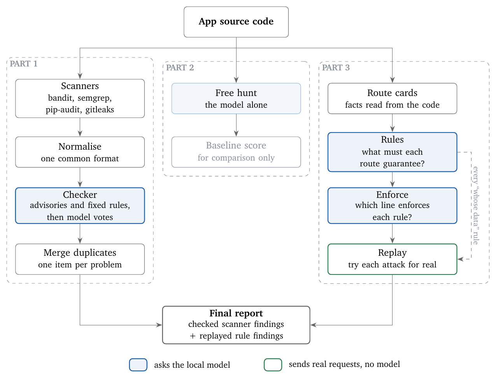

# routeguard

**A security agent for Python/Flask web apps that runs entirely on a laptop.**

routeguard reads the code of a web application and reports its security holes. It uses a small local
model (`qwen2.5-coder:7b` through [Ollama](https://ollama.com), on a MacBook Air M1 with 8 GB of memory),
so no code ever leaves the machine.

The main idea: **a small model is poor at searching for bugs on its own, but good at answering small,
well-posed questions**, as long as ordinary code checks every answer and every claimed attack is actually
tried. So the model is never asked "find the vulnerabilities". It is asked things like "what must this page
guarantee?" and "which line enforces that?", and a finding is only kept once a real request proves it.

> Full write-up, step by step: [`report/routeguard_report.pdf`](report/routeguard_report.pdf).
> Complete working log with every experiment: [`docs/lab-notes.md`](docs/lab-notes.md).
> **What the output looks like:** the security report routeguard writes for each test app:
> [cakeshop](cakeshop/runs/report.md) · [flask-webgoat](flask-webgoat/runs/report.md) · [vulny-app](vulny-app/runs/report.md).

---

## Results

Tested on three deliberately vulnerable apps, each with an answer key of known bugs.

| App | Known bugs | Scanners + checker only: bugs found | Full system: bugs found | Full system: share of findings that are real |
|---|---|---|---|---|
| **cakeshop** (my own, the agent was developed on it) | 19 | 11 | **17** | **90%** |
| **flask-webgoat** (not seen during development; answer key fixed before the run) | 16 | 9 | **12** | **94%** |
| **vulny-app** (logic bugs only; written by another AI model; answer key unseen until after the run) | 8 | 0 | **7** | **67%** |

- The route-by-route part adds exactly the bugs scanners cannot see: reading other users' orders, making
  yourself admin, an admin page with no admin check, negative order quantities, missing CSRF protection.
  Each one is confirmed by a real request, not by the model's word.
- **vulny-app tests that part on code I did not write.** The outside app (flask-webgoat) contains almost
  none of the bugs route-by-route checking is built for, so a second app was generated by a different AI
  model, full of exactly those bugs. routeguard found 7 of its 8 bugs, confirmed 5 with a real request,
  every confirmed finding was real, and none of its 5 decoys was reported.
- On cakeshop, only 1 of 8 *decoys* (safe code that looks dangerous) was reported.
- **Every finding was checked by hand** against the code and the replay log. The automatic scorer only
  credits a finding within 2 lines of the line the answer key marks, so it misses findings that report the
  right bug on, say, the route's first line, and it counts real problems the answer key forgot (outdated
  libraries, a second unprotected form) as wrong. Its stricter numbers are 17/19 at 90%, 11/16 at 76% and
  6/8 at 33%. Every hand decision is written down, with its reason, in each app's `labels/hand_check.json`,
  and `python3 ../tools/score.py runs/merged.json runs/replay.json --hand` reproduces the table above.
- These are single runs on small apps. They are indications, not proof.

What it still misses, and why, is analysed bug by bug in section 13.3 of the report. In short: code that
runs outside the app's routes (start-up settings, after-request hooks, logging), passwords stored in plain
text, and two wrong judgements by the model in the rules step.

## Design decisions

The brief left open what an agent is, what it may do, how it verifies a finding and how it explains it.
These are the choices, and the evidence behind each:

| Decision | Why |
|---|---|
| The model never searches for bugs; it answers narrow questions ("who may call this route?", "which line enforces this rule?") | Asked to search freely, the same model found 0 of 6 logic bugs for the right reason. Given all of each route's code and the same open question (a control run), still only 1 of 6, and 5 of 8 decoys accused. Asked the narrow questions, with the same code, it wrote 8 of the 9 rules needed to catch them |
| Code checks every model answer | The model's "yes, it is enforced" was wrong on the admin page; the code check (the quoted line does not run for this route) overruled it |
| A finding is kept only if a real request proves it | On cakeshop, replay turned 23 rule findings (78% real) into 16 (100% real) |
| The control flow is fixed code, not chosen by the model | A Vulnhuntr-style version that could ask for more code never asked, in 21 of 21 routes. The model gets the code it needs up front instead |
| Tests are designed in code, not by the model | In agent mode the model designed each test: 4 of 8 bugs on vulny-app instead of 7, no false confirmation, but three real bugs passed as safe |
| Fixed rules before the model in the checker | 6 of the 8 false alarms removed on cakeshop were removed by simple rules, only 2 by the model |
| What it may do: read the code, and send requests to an in-process copy of the app with test users | No network, nothing outside 127.0.0.1, payloads that at most create one empty marker file |
| Knowledge: OWASP Top 10 / API Top 10 / ASVS as the list of rule types, not as retrieved text | Adding 12 OWASP and Flask notes to the checker's prompt changed nothing (one verdict better, one worse), so they were removed |
| No fine-tuning | 8 GB of memory, and the experiments showed the bottleneck was the format of the question, not missing knowledge |

### What "agent" means here

In the classic sense (a system that perceives its environment, acts on it, and changes its conclusions based
on what it observes), routeguard is an agent: it starts the app, sends attacks as different users, watches
what changes in the database and the response, and drops or keeps each claim based on that outcome.

The control stays in code and the model answers questions at chosen points. That is a deliberate decision,
not a missing feature, and the alternative was tried twice. The free hunt gave the model a "show me more
code" tool; it never used it. **Agent mode** (`agent/investigate.py`)
gives the model control over how each finding is tested: for every broken rule it designs the test (which
user, which field, which bad value, which kind of probe), and the same code checks as replay decide whether
the test proved anything. For dangerous probes the model only names the kind; code supplies the harmless
payload. On vulny-app, on the same 27 rules (one run, hand-checked):

| Who designs the test | Bugs found | Confirmed by a real request | False confirmations |
|---|---|---|---|
| Code (replay) | 7/8 | 5 | 0 |
| The model (agent mode) | 4/8 | 4 | 0 |

The agent confirmed nothing false, but its failures are quiet: it picked `:999999` (not a number at all) as
the out-of-range value for seats, so the negative-seats bug passed as safe, and for the client-sent total and the role/credit fields it picked a
template-injection probe, found nothing, and marked two real bugs safe that replay keeps for a human. So with
a 7B model the tests stay designed in code; the model's test design is only worth using where replay has no
test at all, with its "safe" verdicts sent to a human. `tools/compare_modes.py` lines the two modes up rule
by rule.

## How it works

<p align="center">
  
</p>

Blue boxes ask the local model a question; every other box is ordinary code. Part 2 is only a yardstick
and does not feed the final report.

**Part 1: scanners plus a checker.** Four standard scanners produce warnings. A checker decides which are
real, using the cheapest step that can decide each one: known library advisories, fixed rules (a secret
typed into the code, MD5 passwords, debug mode...), and only then the local model. The model must explain
where the data comes from, how it reaches the line and what protects it *before* giving a verdict, and it
votes three times. Duplicate warnings for the same problem are merged.

**Part 2: free hunt (a baseline, not part of the final system).** The model alone, asked to find bugs. It
found 0 of the 6 logic bugs for the right reason: it reacts to code that *looks* dangerous, but these bugs
are *missing* lines (no ownership check, no admin check). A control run that gives it all of each route's
code (the same context Part 3 uses) found 1 of 6, and flagged more decoys. So the question, more than the
context, is the problem. This result shaped Part 3. The prompts of every step, and what each one expects back,
are in section 10 of the report.

**Part 3: checking each route against the rules it must follow.**

1. **Route cards** (plain Python, no model): for every route, the facts readable from code: what the user
   sends, which tables it reads and writes, which decorators protect it.
2. **Rules** (model): four short questions per route, based on OWASP: who may call it, whose record it is,
   does it change data (decided by code, for CSRF), and for each value the user sends, what kind of value
   it is (ordinary content, a record id, something the server must decide, a number that needs limits, a
   field the user must not set).
3. **Enforce** (model, checked by code): for each rule, which line enforces it? Code verifies that the
   quoted line exists and actually runs for this route.
4. **Replay** (no model): each unenforced rule becomes a real request against a local copy of the app,
   with three test users (admin, alice, bob). For example, bob opens alice's order, or sends `is_admin=1`.
   A finding is kept only if the attack works.

## Quick start

Requirements: Python 3.10 or newer, [Ollama](https://ollama.com), and [gitleaks](https://github.com/gitleaks/gitleaks)
on your `PATH`. The agent code itself uses only the Python standard library.

```bash
# scanners (once)
python3 -m venv agentenv && agentenv/bin/pip install -r requirements-agent.txt

# the target app's own libraries, used by the replay step
python3 -m venv appenv && appenv/bin/pip install -r cakeshop/requirements.txt

# the local model
ollama pull qwen2.5-coder:7b

# run the whole pipeline on one app and score it
./run.sh cakeshop
```

`run.sh` runs every step in order, writes the human-readable report to `<app>/runs/report.md`, and prints
the score if the app has an answer key. Every step reads and
writes fixed files, so each one can also be run on its own (see `docs/lab-notes.md`, section 16).
`rerun.sh` re-runs everything after the scanners and keeps a copy of the outputs, and can make sampled
repeat runs (`AGENT_TEMP`, `AGENT_SEED`).

The saved results of the reported runs are already in each app's `runs/` folder, so the numbers can be
checked without running anything:

```bash
cd cakeshop
python3 ../tools/score.py runs/merged.json runs/replay.json --hand     # full system, with the hand check
python3 ../tools/score.py runs/merged.json runs/replay.json            # automatic score only
python3 ../tools/score.py runs/merged.json runs/replay.json --strict   # also requires the right weakness type
python3 ../tools/report.py                                             # rewrite runs/report.md
```

## Test apps

**cakeshop** is included. **vulny-app** is included too: it was generated for this project by a different AI
model, from a short specification of the bugs to plant.

**flask-webgoat** belongs to other authors, so its code is **not** stored here. One script downloads it at
the exact version used for the results:

```bash
scripts/get_test_apps.sh
```

It fetches [flask-webgoat](https://github.com/ShiftLeftSecurity/flask-webgoat) (Apache-2.0 licence) into
`flask-webgoat/`. The only change it makes is to delete the author's `# vulnerability: ...` comments, so the
model cannot read the answers in the code. This repository keeps only my own files for it: the answer key,
the replay configuration and the saved results.

The apps pin different library versions, so rebuild `appenv/` before switching:

```bash
rm -rf appenv && python3 -m venv appenv
appenv/bin/python -m pip install -r vulny-app/requirements.txt
./run.sh vulny-app

rm -rf appenv && python3 -m venv appenv
appenv/bin/python -m pip install Flask==2.2.4 Werkzeug==2.3.7 Jinja2==3.1.2
./run.sh flask-webgoat
```

(flask-webgoat pins Flask 1.1.2, which needs an old Python; the saved results were replayed with Flask
2.2.4, and the replayed bugs do not depend on the version.)

## Repository layout

| Path | What it is |
|---|---|
| `agent/` | The agent: checker (`verify.py`), free hunt (`hunt.py`), route cards (`routecard.py`), rules (`rules.py`), enforce (`enforce.py`), replay (`replay.py`), code index (`codeindex.py`), Ollama client (`llm.py`), and the agent-mode experiment (`investigate.py`) |
| `tools/` | Normalising scanner output, merging duplicates, the human-readable report (`report.py`), scoring against answer keys (`score.py`), and comparing replay with agent mode (`compare_modes.py`) |
| `cakeshop/` | My test app with 19 planted bugs and 8 decoys; answer key and hand check in `labels/`, results and the security report (`runs/report.md`) in `runs/` |
| `vulny-app/` | A generated test app with 8 logic bugs and 5 decoys, made to test route-by-route checking; answer key and hand check in `labels/`, results in `runs/` |
| `flask-webgoat/` | My files for the outside test app (its code comes from `scripts/get_test_apps.sh`) |
| `report/` | The project report (PDF and LaTeX source) |
| `docs/lab-notes.md` | The full working log: every experiment, every number, every change |
| `run.sh`, `rerun.sh` | Run the whole pipeline on one app |
| `LICENSE` | MIT, for my own code; flask-webgoat keeps its own Apache-2.0 licence |

Each app folder has a `replay_config.json`: the only app-specific input the agent needs (how to start the
app, where its database is, which test users exist). A new app needs a new config file, not new code.

## Limitations

- Three small, deliberately vulnerable apps; single runs of a 7B model. A real codebase, where most code is
  fine, would test false alarms much harder.
- The prompts were developed on cakeshop. flask-webgoat and vulny-app were not used to tune any prompt or rule.
- vulny-app was generated on request, so its bugs are textbook examples, easier than real code.
- The final counts were checked by hand by me. Every decision is listed with its reason in
  `labels/hand_check.json`, so it can be checked, but a second reviewer would make it stronger.
- Python/Flask only. Route cards do not yet understand ORM models (SQLAlchemy), class-based views or some
  ways of registering routes.
- It sees routes well and little else: code that runs at start-up, after a request, or in logging is
  outside its view.

The report covers these, and the next steps, in detail.

## Safety

All three test apps are deliberately vulnerable. Run them only on `127.0.0.1` and never expose them to a
network. The replay step attacks a local copy of the app inside the test process; its payloads are harmless
by design (the strongest one creates a single empty file). Use routeguard only on code you own or are
authorised to test.
